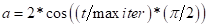
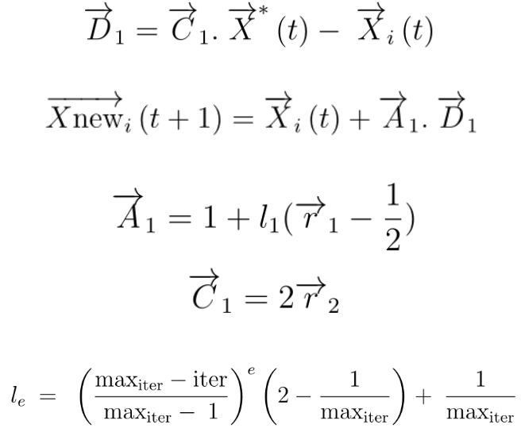
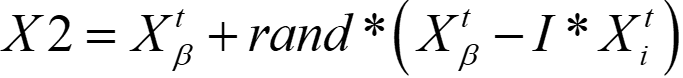
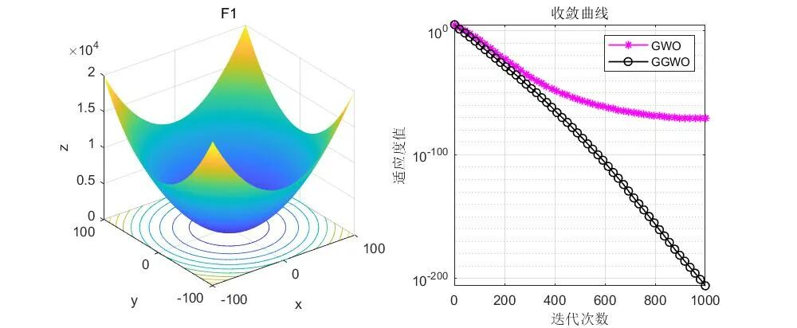
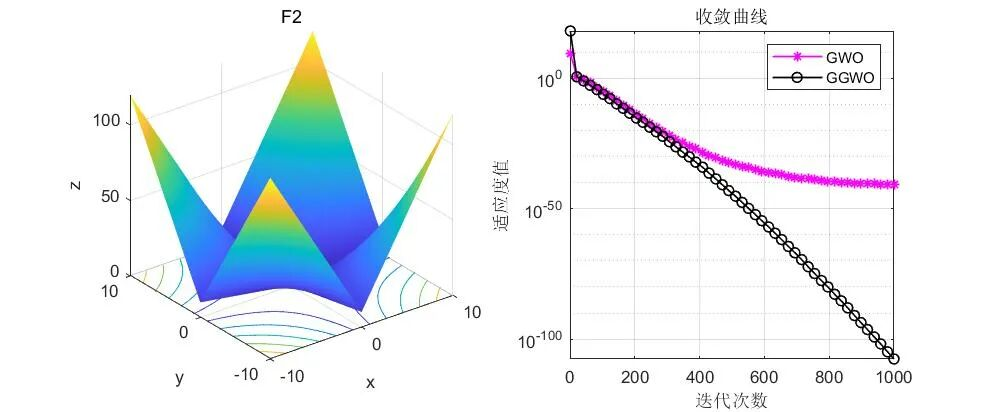
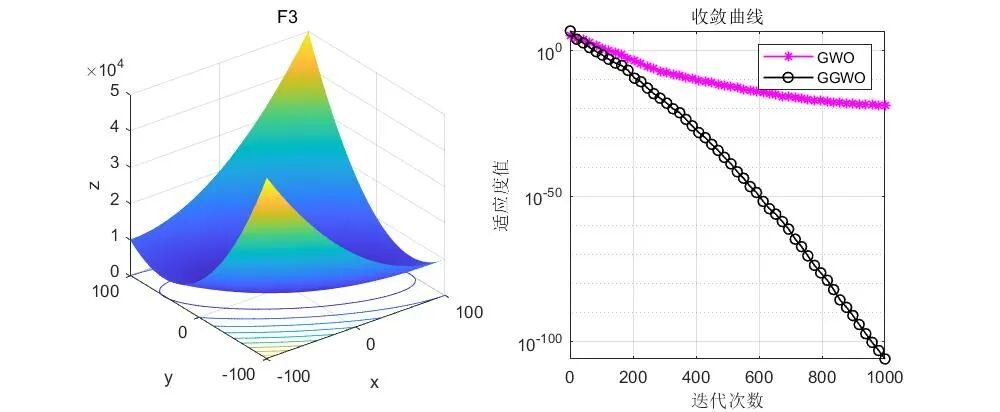
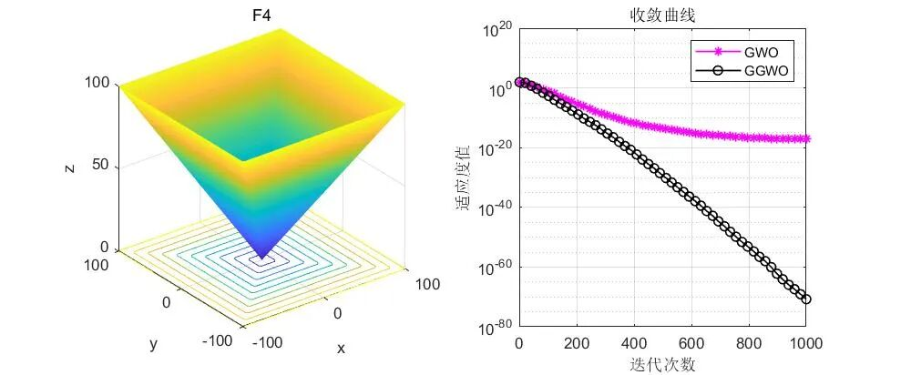
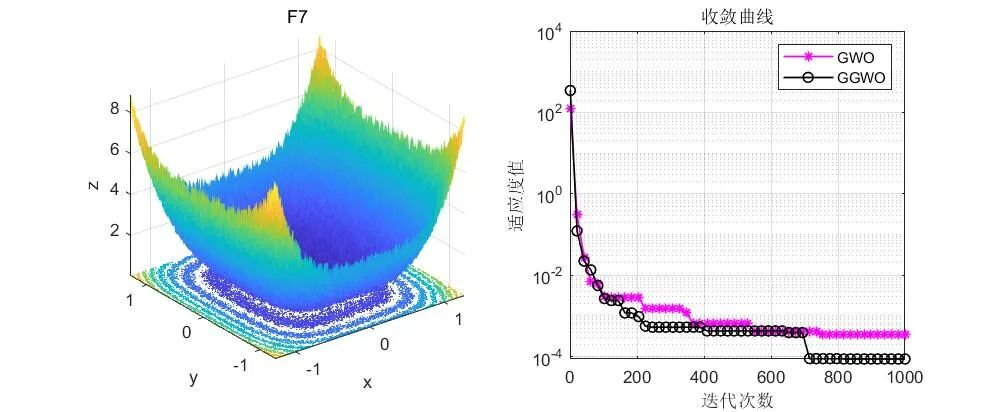

# Improved Gray Wolf Algorithm with the Thought of Taojin Optimizer

Firstly, it should be declared that the algorithm is a modification of the Gray Wolf Algorithm by the author based on the Gold Rush Optimizer algorithm, without any reference to such a modification in the literature. It is purely an improvement made by the author.

Frequently, there are questions from friends and colleagues in the back:
"Can the algorithm improved by the author be used for writing papers?"
The answer is: Of course!
If my article can help everyone write papers, it would be the honor of the author!
As for why the choice of the Gold Rush Optimizer was made, during the previous session introducing the Gold Rush Optimizer, the author found that many formulas of this algorithm are similar to those of the Gray Wolf Algorithm, but its effect is better than that of the Gray Wolf Algorithm. Therefore, today, I borrow some ideas from the Gold Rush Optimizer to improve the Gray Wolf Algorithm.
Detailed explanation of principle
It should be emphasized that this program's improvements are not complex, suitable for beginners. The program does not increase the complexity of the algorithm; each loop only calls the fitness function once. The efficiency is very high!
There are four points of improvement:
Improvement point 1: Chaos map;
This improvement adopts the tent chaos map.
Improvement point 2: Improved convergence factor;
Improvement point 3: Referring to the migration formula of miners prospecting for gold in the Gold Rush Optimizer to update the alpha wolf in the Gray Wolf Algorithm.
Improvement point 4: Modified X2 update formula
Results display
Code display

## Images

<!-- PAYMENT_BLOCK -->

## Get this dataset

- Payment link (Stripe): [Buy now](https://buy.stripe.com/3cs8yP7sY87d0vu9AB)
- Payment QR code: 

<!-- /PAYMENT_BLOCK -->
